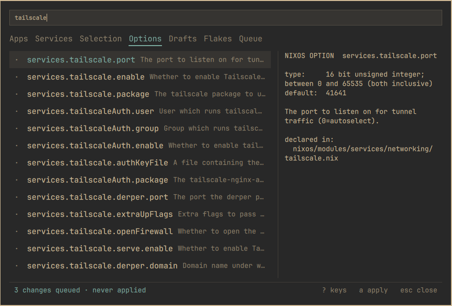
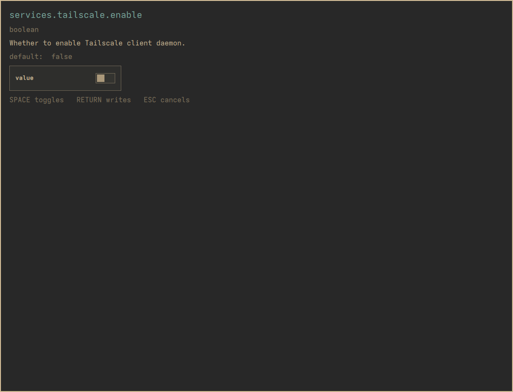
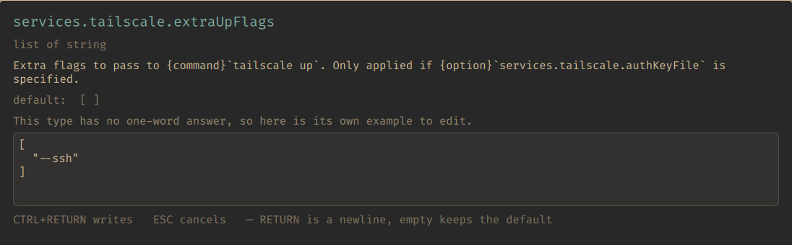

# NixOS options

This tab lists options discovered from your host's flake, including NixOS
options and, when available, Home Manager options for your user. This is how
you reach a service the curated catalogue does not carry.

`/` searches. Each row shows the option's path and its declared type.

## Where the options come from

The list is read from your own flake: the options of the host you are on,
including those your modules declare and the `programs.nixarchy.*` ones. It
is read when the index is rebuilt (`r`) and after every apply, in the
background, and cached.

- The footer says `options: system manual` until that has happened. The
  list is then NixOS's manual, which does not know your own modules.
- `options: reading your flake…` means a read is running.
- Editing a module without applying is not seen until the next apply or
  reindex.
- On a git flake, files you have not `git add`ed are invisible, exactly as
  they are to the rebuild.
- A cache built for another flake, host or user is never used.

## Setting one

`RETURN` opens a form built from the option's declared type. Not a text box
with a label — an actual widget, when the type admits one.

| Type | What you get |
| --- | --- |
| `boolean` | A checkbox. `SPACE` flips it |
| enum | The alternatives, `j`/`k` to choose |
| `int` | A number field |
| simple string / path | A text field |
| anything else | See below |

The type, the documentation and the default are all shown. `RETURN` writes,
`ESCAPE` cancels.

## An untouched field writes nothing

This is the rule worth internalising, and it is deliberate.

The value the form shows you is the **default** — or, when the option is
already set, the value in `apps.nix`, labelled *set in apps.nix*. If you
leave it alone and
press `RETURN`, nothing is written — because the default is already in force,
and a copied-out default is a line that *reads* like a decision and is not
one. Six months later you cannot tell which of your option lines you meant
and which the form put there.

So: change it, or cancel. Both are honest. Writing out what was already true
is not.

## Why some options get a text box instead of a widget

Booleans, enums, integers and simple strings get a real widget. Lists,
`null or T`, attribute sets, submodules and functions do not.

They get the option's own example — or its default — in a text box, with
its type and documentation beside it. Edit it and RETURN writes it as a
live value; leave it untouched and nothing is written.

That is not the form giving up. A widget for "a list of submodules" would
have to pretend to understand Nix, and the first thing it would do is let you
write something that parses and means the wrong thing. A plain text box with
the real example in it, which you edit as Nix, gets you further than a widget
that guesses.

The writer runs a parse check either way, so a value that would leave the
file unparseable is refused and nothing is changed — and the message you get
is nix's own words rather than a guess at them.

## Changing one

`RETURN` on an option that is already set opens the form on its value.
Change it and press `RETURN`, and the line is replaced where it stands, in one
step that either changes it or leaves the file exactly as it was. A value the
widget cannot hold exactly — `lib.mkDefault true`, an expression — opens as its
own text to edit.

## Removing one

`SPACE` on an option row that is already set removes it. The option reverts
to its default, which is what it was before you touched it.

## User scope

Home Manager options appear with a **user** badge. They are written to `home.nix` for the account running the panel. This requires Home Manager as a NixOS module, that account in `home-manager.users`, and a nixarchy version with the Home Manager part. A disabled row shows the reason.

Removing a selection can leave a declaration elsewhere in the flake in effect. `check` evaluates the combined configuration and reports conflicting option values.
